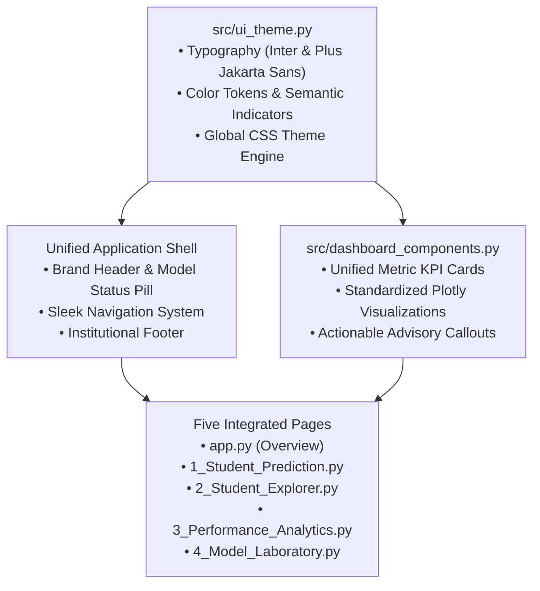
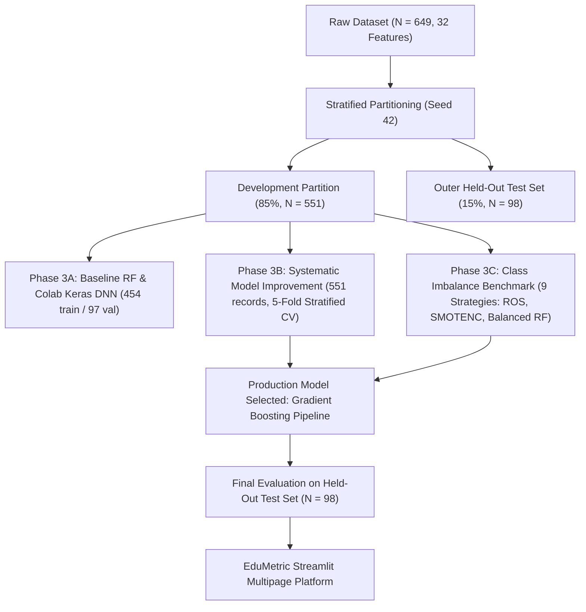

# EduMetric — Academic Performance Prediction & Intelligence Platform

An institutional-grade, evidence-based academic performance analytics and early warning platform. Leveraging calibrated machine learning, **EduMetric** enables university administrators, educators, academic advisors, and institutional researchers to forecast student performance cohorts, identify students needing academic support early, and examine multi-dimensional drivers of educational outcomes through an executive SaaS interface.

---

## 🎯 1. Project Overview & Key Capabilities

- **Cohort Performance Prediction:** Forecasts final student examination outcomes into four discrete performance categories from 32 holistic demographic, behavioral, and academic indicators.
- **Empirical Model Calibration:** Powered by a tuned Scikit-Learn **Gradient Boosting Pipeline** that achieves **72.45% accuracy** and **0.7516 Macro F1-Score** on an independent held-out test cohort ($N = 98$), outperforming both Random Forest ($66.33\%$) and Deep Neural Network ($68.37\%$) architectures.
- **Ordinal Boundary Safety:** Produces **zero severe category errors** ($|\text{Error}| > 1$ category bracket) on the test cohort; 100% of residual misclassifications are confined strictly to adjacent grade categories.
- **Unified SaaS Design System:** Built on a cohesive design system featuring deep midnight slate surfaces, electric indigo accents, modern typography (Inter & Plus Jakarta Sans), and calibrated semantic status indicators.
- **Interactive Multi-Page Intelligence Suite:** Features five integrated modules delivering overview KPIs, single-student scenario simulation, filterable cohort exploration, multi-variable analytical distributions, and a machine learning research laboratory.
- **Responsible AI by Design:** Operates under explicit ethical guardrails: probabilistic class scores rather than deterministic labels, non-punitive recommendation logic, and transparent disclosure of dataset boundaries and predictive signal concentration.

---

## 🎨 2. Design System & Frontend Architecture

EduMetric features a centralized design system implemented in `src/ui_theme.py`:



### Visual Tokens & Semantic Palette
- **Primary Brand Identity:** Deep Midnight Slate (`#090D1A`, `#0F172A`, `#1E293B`)
- **Accent & Interaction:** Electric Indigo (`#4F46E5`, `#6366F1`) and Institutional Cobalt (`#2563EB`)
- **Canvas & Surfaces:** Whisper Slate background (`#F8FAFC`), pure white container cards (`#FFFFFF`), subtle slate strokes (`#E2E8F0`)
- **Calibrated 4-Tier Performance Indicators:**
  - **Poor (0–9 Marks):** Crimson / Rose (`#E11D48`, soft surface `#FFF1F2`, border `#FECDD3`)
  - **Average (10–12 Marks):** Warm Amber (`#D97706`, soft surface `#FFFBEB`, border `#FDE68A`)
  - **Good (13–15 Marks):** Royal Cobalt (`#2563EB`, soft surface `#EFF6FF`, border `#BFDBFE`)
  - **Excellent (16–20 Marks):** Emerald Jade (`#059669`, soft surface `#ECFDF5`, border `#A7F3D0`)

---

## 🛠️ 3. Technology Stack

- **Core Runtime:** Python 3.10+ (tested on Python 3.14)
- **Data Engineering & Manipulation:** Pandas, NumPy
- **Machine Learning & Pipelines:** Scikit-Learn, Joblib
- **Data Visualization:** Plotly Express, Plotly Graph Objects
- **Web Application & UI Framework:** Streamlit (Native Multipage Architecture)
- **Zero Local TensorFlow Dependency:** Deep Neural Network training was conducted in Google Colab; local application inference and laboratory visualization execute natively in Scikit-Learn without triggering Windows security DLL policy blocks.

---

## 📊 4. Dataset Description & Performance Schema

### Dataset Source & Cohort Profile
The platform is calibrated on the benchmark **UCI Student Performance Portuguese Dataset** (`data/student-por.csv`), tracking **649 secondary school students** enrolled in Portuguese language courses across two secondary institutions:
1. **GP:** Escola Secundária Gabriel Pereira (Évora, Portugal) — 423 students ($65.2\%$)
2. **MS:** Escola Secundária Mousinho da Silveira (Portalegre, Portugal) — 226 students ($34.8\%$)

The dataset contains **32 input features** (15 numerical and 17 categorical) with zero missing values and zero duplicate records, spanning family background, study habits, school support, social behaviors, and interim academic grades.

### Four Performance Categories & Grade Boundaries
Final grades (`G3`, on a standard 0–20 point scale) are mapped to four discrete academic categories:

| Target Class | Category Name | Grade Range | Total Count | Class Share | Cohort Academic Standing |
|:---:|:---:|:---:|:---:|:---:|:---|
| **0** | **Poor** | **0–9** | 100 | 15.4% | Below passing threshold; requires immediate academic intervention |
| **1** | **Average** | **10–12** | 273 | 42.1% | Satisfactory baseline standing; sensitive to minor score shifts |
| **2** | **Good** | **13–15** | 194 | 29.9% | Solid academic proficiency across core learning objectives |
| **3** | **Excellent** | **16–20** | 82 | 12.6% | Outstanding mastery; candidates for advanced enrichment |

---

## 🔬 5. Model Development Methodology



1. **Phase 1 (Verification):** Audited schema consistency, data types, missing values, duplicates, and feature boundaries.
2. **Phase 2 (EDA & Partitioning):** Generated 7 baseline exploratory distributions and fitted a leak-free `ColumnTransformer` (`StandardScaler` + `OneHotEncoder`).
3. **Phase 3 (Initial Modeling):** Trained a baseline Random Forest locally and a 3-layer deep neural network (Dense 64 -> Dropout 0.25 -> Dense 32 -> Dropout 0.15 -> Softmax 4) in Google Colab (50 epochs, min validation loss 0.5431 at epoch 38).
4. **Phase 3B (Model Improvement):** Systematically evaluated 87 candidate configurations across 5 model families on the 551-record development set using 5-fold stratified cross-validation. Regularized shallow-depth Gradient Boosting emerged as the top performer.
5. **Phase 3C (Imbalance & Generalization Audit):** Evaluated 9 balancing strategies. While RandomOverSampler tied baseline on cross-validation ($0.8110$ vs. $0.8115$ Macro F1), testing on held-out records showed oversampling increased boundary false positives and degraded Poor-class precision ($72.2\% \rightarrow 65.0\%$). The natural-distribution Gradient Boosting pipeline was therefore retained for production stability.
6. **Phase 4 & 5 (Application Integration & QA):** Developed a 5-module Streamlit interface with verified artifact parity, non-judgmental recommendations, and robust error handling.

---

## 🏆 6. Final Model Performance Metrics

Evaluated on the independent, held-out outer test cohort ($N = 98$):

| Architecture / Model | Test Accuracy | Macro Precision | Macro Recall | Macro F1-Score | Weighted F1-Score | Severe Errors |
|:---|:---:|:---:|:---:|:---:|:---:|:---:|
| **Random Forest (RF)** | 66.33% | 66.01% | 72.62% | 0.6779 | 0.6603 | 0 (0.0%) |
| **Deep Neural Net (DNN)** | 68.37% | 66.38% | 69.89% | 0.6747 | 0.6867 | 0 (0.0%) |
| **Gradient Boosting (Production)** | **72.45%** | **75.13%** | **77.53%** | **0.7516** | **0.7206** | **0 (0.0%)** |

### Per-Class Performance Breakdown (Production Gradient Boosting)

| Performance Category | Support (N = 98) | Precision | Recall | F1-Score |
|:---|:---:|:---:|:---:|:---:|
| **Poor (0–9)** | 15 | **72.2%** | **86.7%** | **0.7879** |
| **Average (10–12)** | 41 | 82.1% | 56.1% | 0.6667 |
| **Good (13–15)** | 29 | **61.5%** | **82.8%** | **0.7059** |
| **Excellent (16–20)** | 13 | **84.6%** | **84.6%** | **0.8462** |

### Test Error Distribution Deep Dive
- **Total Test Samples:** 98
- **Correct Classifications:** 71 ($72.45\%$)
- **Total Misclassifications:** 27 ($27.55\%$)
- **Severe Misclassifications ($|\text{Error}| > 1$ category bracket):** **0 ($0.0\%$)**
- **Adjacent Boundary Errors ($|\text{Error}| = 1$ category bracket):** **27 ($100.0\%$ of errors)**
  - 13 Average students (actual 10–12) predicted as Good (13–15)
  - 5 Average students predicted as Poor (0–9)
  - 5 Good students (actual 13–15) predicted as Average (10–12)
  - 2 Poor students (actual 0–9) predicted as Average (10–12)
  - 2 Excellent students (actual 16–20) predicted as Good (13–15)

---

## 🧭 7. Platform Modules Overview

The EduMetric application is organized into five specialized modules:

1. **🏠 Overview Dashboard (`app.py`):**
   - High-level executive summary presenting dataset size, input feature counts, model architecture, test accuracy, and Macro F1 KPIs.
   - Interactive Plotly distribution of the four target classes across the 649-student cohort.
   - Summaries of key exploratory data findings and responsible AI usage guidelines.

2. **🔮 Student Prediction (`pages/1_Student_Prediction.py`):**
   - Real-time inference engine accepting all 32 raw student features in canonical order.
   - Pre-populated profile presets (*Average Baseline*, *High-Achieving*, *Academic Support*).
   - Generates predicted category, grade range estimate, and full 4-class score distributions (summing to $1.0$).
   - Formulates tailored, non-judgmental educational support recommendations focused on actionable habits (study routine structuring, tutoring, attendance reconciliation).

3. **🔎 Student Explorer (`pages/2_Student_Explorer.py`):**
   - Interactive in-memory cohort exploration with 11 independent and combined filter dimensions (school, gender, category, study time, failures, internet, address, age, absences).
   - Fast lookup by anonymous student identifier (`Student-001` through `Student-649`).
   - Dynamic KPI summaries, category breakdown charts, and one-click CSV export of filtered cohorts.

4. **📊 Performance Analytics (`pages/3_Performance_Analytics.py`):**
   - Statistical investigation suite examining grade distributions, longitudinal correlations, study duration tiers, past academic setbacks, and absenteeism patterns.
   - 15-variable Pearson correlation matrix with automated empirical insight generation.
   - Observational comparisons contextualized with clear non-causal disclosures.

5. **🧪 Model Laboratory (`pages/4_Model_Laboratory.py`):**
   - Empirical machine learning research arena comparing Random Forest, Keras DNN, and Gradient Boosting.
   - Interactive confusion matrices, built-in Gini importance ($G2 = 82.74\%$, $G1 = 9.76\%$), and model-agnostic permutation importance.
   - Complete 10-pipeline 5-fold cross-validation benchmark table and 9-strategy imbalance experiment analysis.
   - DNN training convergence curves (loss/accuracy over 50 epochs) rendered without local TensorFlow execution.

---

## 📁 8. Project Directory Structure

```text
Academic Prediction/
├── app.py                               # Application entrypoint & Overview Dashboard
├── README.md                            # Comprehensive platform documentation
├── requirements.txt                     # Application runtime dependencies
├── data/
│   └── student-por.csv                  # Original UCI Portuguese secondary dataset (N = 649)
├── pages/
│   ├── 1_Student_Prediction.py          # Module 1: Prediction Engine & Advisory
│   ├── 2_Student_Explorer.py            # Module 2: In-Memory Dataset Explorer & Export
│   ├── 3_Performance_Analytics.py       # Module 3: Multi-Variable Analytics Dashboard
│   └── 4_Model_Laboratory.py            # Module 4: Machine Learning Research Arena
├── src/
│   ├── __init__.py
│   ├── ui_theme.py                      # Centralized UI Design System & Theme Engine
│   ├── app_utils.py                     # Cached artifact loaders & inference helpers
│   ├── dashboard_components.py          # Modular Plotly charts & styled KPI cards
│   ├── preprocessing.py                 # Pipeline construction & feature transformers
│   ├── improve_models.py                # Hyperparameter tuning & experiment scripts
│   └── oversampling_experiments.py      # Imbalance evaluation experiments
├── models/
│   ├── best_improved_model.joblib       # Production fitted Gradient Boosting Pipeline
│   ├── random_forest.joblib             # Phase 2 fitted baseline Random Forest
│   └── dnn_model.keras                  # Colab-trained Keras Deep Neural Network
├── artifacts/
│   ├── class_mapping.json               # Target category boundaries metadata
│   ├── feature_names.json               # Canonical 32 input feature names
│   ├── split_metadata.json              # Partition sizes and random seeds
│   ├── X_train.npy, X_val.npy, X_test.npy # Preprocessed feature arrays
│   └── y_train.npy, y_val.npy, y_test.npy # Target arrays
├── assets/
│   ├── improved_model_metrics.json      # Production model CV and test metrics
│   ├── improved_model_predictions.npy   # Production model test predictions (N = 98)
│   ├── improved_model_feature_importance.csv # Built-in Gini feature importance
│   ├── rf_metrics.json, dnn_metrics.json # Baseline comparison metric JSONs
│   ├── training_history.json            # 50-epoch DNN training history
│   └── oversampling_experiment_results.csv # 9-strategy imbalance experiment results
└── experiments/
    └── final_audit/
        ├── model_comparison_results.csv # 10-candidate 5-fold CV benchmark results
        ├── permutation_importance.csv   # Permutation importance on development data
        ├── test_prediction_engine.py    # Phase 4B test suite
        ├── test_student_explorer.py     # Phase 4C test suite
        ├── test_performance_analytics.py # Phase 4D test suite
        ├── test_model_laboratory.py     # Phase 4E test suite
        └── test_final_integration.py    # Phase 5 End-to-End integration test suite
```

---

## 🚀 9. Installation & Application Launch

### Prerequisites
- Python 3.10, 3.11, 3.12, 3.13, or 3.14.
- Windows PowerShell, Command Prompt, or Linux/macOS terminal.

### Step 1: Clone or Open the Repository
Navigate to the project root directory:
```bash
cd "Academic Prediction"
```

### Step 2: Set Up Virtual Environment (Recommended)

**Windows PowerShell:**
```powershell
python -m venv .venv
.\.venv\Scripts\Activate.ps1
```

**Linux / macOS:**
```bash
python3 -m venv .venv
source .venv/bin/activate
```

### Step 3: Install Dependencies
```bash
pip install -r requirements.txt
```

### Step 4: Launch the Streamlit Application

**Windows PowerShell (Dedicated Virtual Environment Command):**
```powershell
.\.venv\Scripts\streamlit run app.py
```

**Standard Cross-Platform Command (with active virtual environment):**
```bash
streamlit run app.py
```

Once launched, access the platform in your browser at `http://localhost:8501`.

---

## ⚖️ 10. Limitations & Responsible AI Principles

1. **Dataset Specificity:** The system is calibrated on 649 secondary school students from two schools in Portugal enrolled in Portuguese language courses. Academic structures, grading curves, and socio-cultural dynamics vary significantly across international jurisdictions. The model is **not externally validated** for dissimilar educational environments.
2. **Prior Grade Reliance:** Predictive accuracy is heavily anchored by interim grades ($G2$ accounts for $82.74\%$ and $G1$ accounts for $9.76\%$ of built-in Gini importance). If interim evaluations are withheld, predicting final grades purely from socio-demographic features drops Macro F1 to approximately $\sim 0.38$.
3. **Correlation vs. Causation:** Demographic, behavioral, and household factors (e.g., parental education, internet access, study duration) reflect observational statistical associations within this cohort and must never be interpreted as direct mechanical causes of academic achievement.
4. **Average Bracket Boundary Sensitivity:** The *Average* class spans a narrow 3-point grade range (grades 10–12). Small 1-mark variations around the 9/10 and 12/13 boundaries can alter categorical classification.
5. **Human-in-the-Loop Guidance:** EduMetric is engineered strictly as an early advisory and support tool. Model outputs are probabilistic indicators intended to guide targeted tutoring and student support, **never** as automated judgments of student worth, disciplinary criteria, or automated academic tracking.
6. **Prior Test Set Exposure Disclosure:** The 98-record outer test partition was evaluated during initial Phase 2 and Phase 3 development iterations; to prevent optimization bias, subsequent Phase 3B and Phase 4 model selections were guided strictly by 5-fold cross-validation on the 551 development records.
